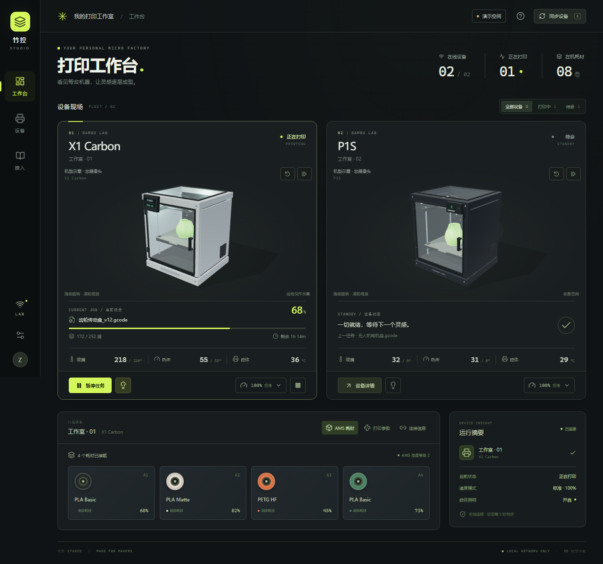

# 竹控 · Bambu Fleet Console

在一个本地网页中同时管理两台拓竹（Bambu Lab）局域网打印机。项目包含完整的双机控制台、演示数据服务，以及基于本地 MQTT 的真机接入层。

> 这不是拓竹官方产品。真机协议可能随型号与固件变化，请在目标设备上先验证状态，再测试控制功能。



## 三维工作台

采用深石墨色界面和原生 Three.js 程序化建模，根据设备配置的 model 字段选择外形：

| 型号 | 三维外形 |
| --- | --- |
| X1 Carbon / X1C | 银灰围封机身、前触摸屏、玻璃门及顶盖 |
| P1S | 深色围封机身、小型显示器、内部打印床及导轨 |
| A1 | 双柱开放龙门与移动热床 |
| A1 mini | 单柱悬臂结构与紧凑底座 |
| 其他型号 | 明确标注的通用打印机示意 |

模型支持拖动旋转、滚轮缩放、方向键调整、Home 或按钮复位，以及自动旋转。打印状态、暂停和腔灯会影响示意动画或模型照明。模型是自建近似外形，打印件和工具头运动均为示意，不是官方 CAD、摄像头或真实工具头轨迹。此处模型适配不代表对应机型的真机控制协议已经验证。

Three.js 按需加载；离屏或页面隐藏时暂停渲染，设备轮询不会重建画布，系统减少动态效果设置会禁用自动动画。WebGL 不可用时显示静态示意，设备状态和控制仍可使用。


## 已实现

- 两台打印机的在线状态、当前任务、进度、层数与剩余时间
- 喷嘴、热床、腔体温度以及风扇状态
- AMS 耗材、余量与湿度等级展示
- 暂停、继续、停止、腔灯与四档速度控制
- 停止任务二次确认、操作反馈、状态筛选与移动端布局
- 本机服务分别维护两路 MQTT 连接；访问码不进入浏览器接口
- 默认演示模式，未配置打印机也能安全体验

当前版本不包含文件上传/发起新打印和摄像头视频。MQTT 状态与控制不等同于视频接入，视频需要按机型单独增加视频网关。

## 快速体验

要求：Node.js 22+ 与 pnpm 10+。

```bash
pnpm install
pnpm dev
```

打开 <http://127.0.0.1:5173>。默认使用演示数据，所有按钮都可体验，但不会连接真实设备。

也可以先启动本机服务，再单独运行 Vite：

```bash
pnpm start       # 终端 1，API 位于 127.0.0.1:8787
pnpm exec vite   # 终端 2
```

## 连接两台真实打印机

### 1. 准备设备信息

在每台拓竹打印机上启用局域网模式，记录：

- 局域网 IP 地址
- 完整设备序列号
- LAN 访问码（Access Code）

电脑和打印机需在同一局域网。服务端需要能够分别连接两台设备的 TCP `8883` 端口。

### 2. 创建本地配置

```bash
cp config/printers.example.json config/printers.local.json
cp .env.example .env
```

Windows PowerShell：

```powershell
Copy-Item config/printers.example.json config/printers.local.json
Copy-Item .env.example .env
```

编辑 `config/printers.local.json`：

```json
[
  {
    "id": "x1c",
    "name": "工作室 · 01",
    "model": "X1 Carbon",
    "ip": "192.168.1.101",
    "serial": "第一台设备的完整序列号",
    "accessCode": "第一台设备的访问码"
  },
  {
    "id": "p1s",
    "name": "工作室 · 02",
    "model": "P1S",
    "ip": "192.168.1.102",
    "serial": "第二台设备的完整序列号",
    "accessCode": "第二台设备的访问码"
  }
]
```

`id` 是控制台内部标识，只可包含字母、数字、下划线和连字符，两台设备不能重复。

### 3. 切换并启动

在 `.env` 中设置：

```dotenv
DEMO_MODE=false
HOST=127.0.0.1
PORT=8787
```

运行 `pnpm dev`，确认页面右上角显示“真机模式”。先核对设备名称、IP 与状态，再按以下顺序验证：

1. 开关腔灯；
2. 暂停并继续一个可安全中断的测试任务；
3. 只在确有需要时验证停止命令。

API 返回“指令已发送”只表示本机 MQTT 客户端已提交报文，不表示设备已经执行；最终状态以打印机的状态回报为准。设备明确拒绝时，卡片会显示对应序号的拒绝原因。MQTT 投递超过 8 秒会返回“执行状态未知”，此时请先核对设备，不要盲目重复发送。

## 生产运行

```bash
pnpm build
pnpm start
```

打开 <http://127.0.0.1:8787>。Express 会直接托管构建后的页面和 API。

## 架构

```text
浏览器控制台（React）
        │ 仅本机 HTTP，无打印机凭据
        ▼
本地服务（Express）
        ├── MQTT/TLS :8883 ── 打印机 A（device/serial/report + request）
        └── MQTT/TLS :8883 ── 打印机 B（device/serial/report + request）
```

服务仅在 MQTT 建立连接时请求一次全量状态，之后合并打印机的主动与增量上报；页面每 5 秒读取一次本机聚合状态。这样可避免在部分 P1 系列上频繁 `pushall` 带来的卡顿风险。

## 安全边界

- 默认只监听 `127.0.0.1`，不会主动开放给局域网其他电脑。
- `.env`、`config/printers.local.json`、证书和密钥均已加入 `.gitignore`。
- 打印机访问码只用于服务端 MQTT 登录，不会通过 `/api/printers` 返回。
- 本地 MQTT 使用 TLS。未提供 CA 时仅加密传输，不完成设备证书身份验证；建议额外配置 `caCertPath` 指向信任的 BBL CA 证书，服务会校验证书链并以设备序列号作为 SNI。
- 不要将未加身份验证和访问控制的本服务直接暴露到公网。
- 如果手动把 `HOST` 改为 `0.0.0.0`，同网络其他设备可能获得控制权限，不建议这样做。

## 测试

```bash
pnpm test
pnpm build
```

测试覆盖命令白名单、速度与腔灯参数、任务及 AMS 增量合并、双机主题隔离、重复目标校验、订阅顺序、投递超时与设备拒绝响应。测试使用内存 MQTT 替身，不代表真机已验证。

## 参考资料与兼容性

- [拓竹官方：打印机网络端口](https://wiki.bambulab.com/en/general/printer-network-ports)
- [拓竹官方：第三方集成与控制授权](https://wiki.bambulab.com/en/software/third-party-integration)
- [拓竹官方：开发者模式说明](https://wiki.bambulab.com/zh/knowledge-sharing/enable-developer-mode)
- [OpenBambuAPI：社区 MQTT 协议记录](https://github.com/Doridian/OpenBambuAPI/blob/main/mqtt.md)
- [Bambu Studio：官方设备控制实现](https://github.com/bambulab/BambuStudio/blob/master/src/slic3r/GUI/DeviceManager.cpp)

官方没有公开完整、稳定的 LAN MQTT API。若出现状态可见但控制被拒绝，请核对当前固件的第三方控制授权要求。开发者模式会改变控制验证并扩大误控风险，不应仅为省事而启用。MQTT 的“停止”也不能替代硬件急停。

## 后续可扩展

- 打印文件列表、上传与启动任务（需要 FTP/文件协议接入）
- 双路摄像头画面（需要独立的视频网关，不应假设 MQTT 能传输视频）
- 操作审计、任务历史与通知
- 多用户访问时的身份认证和细粒度权限
